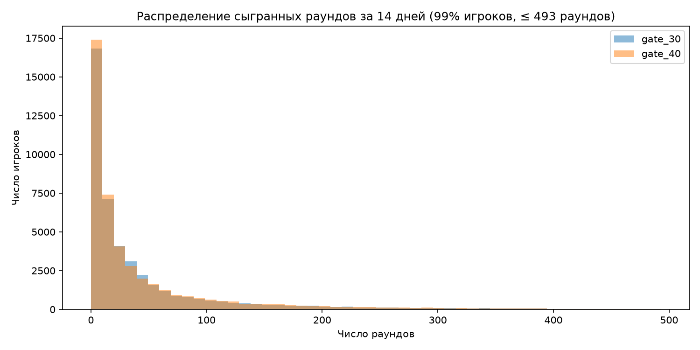
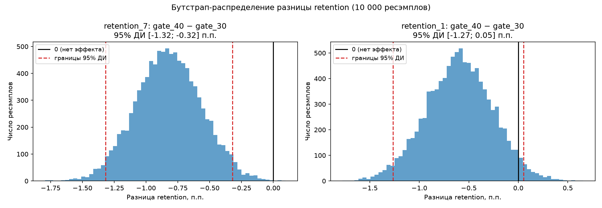

# A/B-тест Cookie Cats

Анализ A/B-теста мобильной игры Cookie Cats: EDA, SRM-проверка, z-тест для двух долей, бутстрап, мощность и MDE.

**Итог:** перенос ворот на 40-й уровень снижает 7-дневное удержание на 0.82 п.п. (19.02% → 18.20%, p = 0.0016). Ворота лучше оставить на 30-м уровне.

## Контекст

В Cookie Cats на некоторых уровнях стоят ворота: чтобы играть дальше, нужно подождать или заплатить. В тесте первые ворота перенесли с 30-го уровня (`gate_30`, контроль) на 40-й (`gate_40`, тест). Вопрос — как это влияет на удержание игроков.

## Датасет

[Mobile Games A/B Testing — Cookie Cats (Kaggle)](https://www.kaggle.com/datasets/yufengsui/mobile-games-ab-testing): 90 189 игроков, колонки `userid`, `version`, `sum_gamerounds` (раунды за 14 дней), `retention_1`, `retention_7`.

В репозитории датасета нет. Скачайте `cookie_cats.csv` и положите в `data/`.

## Структура

```
data/          # cookie_cats.csv (не в git)
images/        # графики
notebooks/     # ab_test_cookie_cats.ipynb — весь анализ
requirements.txt
```

## Как запустить

```bash
python3 -m venv .venv
source .venv/bin/activate
pip install -r requirements.txt
jupyter notebook notebooks/ab_test_cookie_cats.ipynb
```

## Дизайн

- Гипотеза: перенос ворот меняет удержание (направление заранее неизвестно).
- Основная метрика — `retention_7`, вторичные — `retention_1`, `sum_gamerounds`.
- $H_0: p_{40} = p_{30}$, $H_1: p_{40} \neq p_{30}$, $\alpha = 0.05$.
- Решение принимается только по `retention_7`.

## Методы

- EDA: пропуски, дубли, размеры групп, распределение раундов. Один выброс (49 854 раунда) удалён по правилу `sum_gamerounds > 10000`, игроки с 0 раундов оставлены.
- SRM: $\chi^2$-тест размеров групп против 50/50, порог p < 0.001.
- z-тест для двух долей + 95% ДИ разницы, сверка со `statsmodels`.
- Бутстрап: 10 000 ресэмплов, перцентильный 95% ДИ.
- MDE при $\alpha = 0.05$ и мощности 0.8.

## Результаты

После очистки: `gate_30` — 44 699, `gate_40` — 45 489 игроков. SRM нет: $\chi^2 = 6.90$, p = 0.0086.

| метрика | gate_30 | gate_40 | разница, п.п. | отн. разница | z | p-value | 95% ДИ, п.п. |
|---|---|---|---|---|---|---|---|
| `retention_7` | 19.02% | 18.20% | −0.82 | −4.30% | −3.16 | 0.0016 | [−1.33; −0.31] |
| `retention_1` | 44.82% | 44.23% | −0.59 | −1.32% | −1.79 | 0.0739 | [−1.24; 0.06] |

Бутстрап 95% ДИ: `retention_7` — [−1.32; −0.32] п.п., `retention_1` — [−1.27; 0.05] п.п.

MDE для `retention_7` — 0.73 п.п.





## Вывод

`gate_40` не катить. `retention_7` в тестовой группе значимо ниже, бутстрап это подтверждает. `retention_1` тоже ниже, но незначимо.

## Ограничения

- Дизайн восстановлен постфактум.
- p = 0.0086 в SRM-проверке проходит порог 0.001, но перекос групп стоило бы сверить с логами.
- Нет данных о выручке, а ворота — это ещё и монетизация.
- ~63% игроков сыграли меньше 30 раундов и, скорее всего, не дошли до ворот — они разбавляют эффект.
- Retention только на 1-й и 7-й день, нет разрезов по платформе, стране и т.п.
